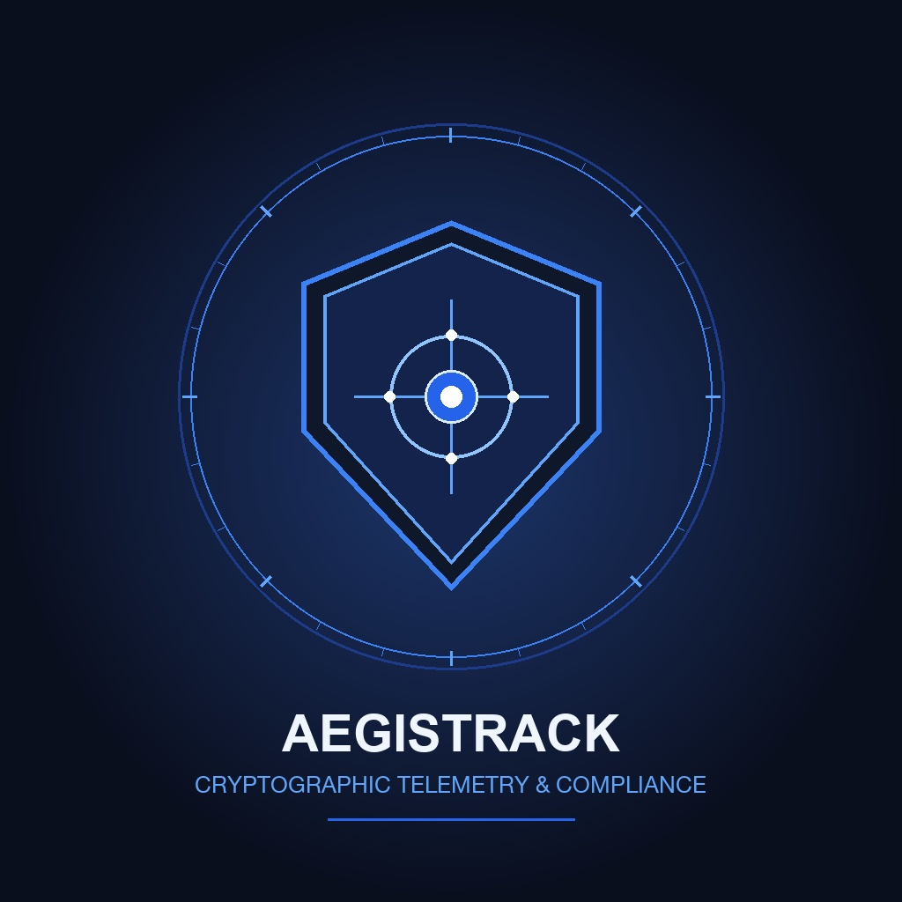

# 🛡️ AegisTrack — Secure Location Logging & Legal Monitoring Platform

<p align=center>
  
</p>

> **Client:** AegisTrack  
> **Architecture:** 4-Tier Tamper-Evident Legal Monitoring Ecosystem  
> **Prepared by:** Slicon Systems LLC  

---

## 1. Executive Overview

**AegisTrack** is an enterprise-grade legal compliance and location verification platform engineered for defense attorneys, supervisory probation officers, and participants (defendants) enrolled in pre-trial release, bail monitoring, or diversion programs.

The platform guarantees tamper-evident auditability through cryptographic document seals, continuous background GPS telemetry, biometric selfie liveness verification, offline-first SQLite synchronization, and court-mandated legal hold record preservation.

---

## 2. Platform Architecture

The ecosystem consists of four interconnected tiers:

```
┌─────────────────────────────────────────────────────────────────────────────┐
│                           1. CLIENT APPS LAYER                              │
│                                                                             │
│   ┌───────────────────────────────┐       ┌─────────────────────────────┐   │
│   │   TRACKED MOBILE APP (app/)   │       │  TRACKER MOBILE APP (app/)  │   │
│   │    (Defendant / Participant)  │       │    (Attorney / Supervisor)  │   │
│   │  • Background GPS Engine      │       │  • Real-time Live Tracking  │   │
│   │  • Facial Liveness Check-in   │       │  • Route History Playback   │   │
│   │  • Offline SQLite Queue       │       │  • Geofence Breach Alerts   │   │
│   │  • SOS & Note Logging         │       │  • Certified Export Request │   │
│   └──────────────┬────────────────┘       └──────────────▲──────────────┘   │
│                  │                                       │                  │
│                  │        ┌──────────────────────────────┴──────────────┐   │
│                  │        │        WEB ADMIN PORTAL (web/)              │   │
│                  │        │    (Compliance & System Administrators)     │   │
│                  │        │  • Next.js 16 (Turbopack) + React 19        │   │
│                  │        │  • 18 Modules: Legal Hold, Audits, Cases,   │   │
│                  │        │    Retention Rules, Sync Failure Diagnosis  │   │
│                  │        └──────────────────────┬──────────────────────┘   │
│                  │                               │                          │
│                  ▼                               ▼                          │
│ ┌─────────────────────────────────────────────────────────────────────────┐ │
│ │              2. FIREBASE & INFRASTRUCTURE LAYER (firebase/)             │ │
│ │   • Firestore (Real-Time Streams & Strict RBAC Security Rules)          │ │
│ │   • Cloud Functions (Geofence Breach Evaluation & FCM Push)             │ │
│ │   • Firebase Storage (Selfie Check-Ins, Signatures & PDF Vault)         │ │
│ └────────────────────────────────┬────────────────────────────────────────┘ │
│                                  │                                          │
│                                  ▼                                          │
│ ┌─────────────────────────────────────────────────────────────────────────┐ │
│ │              3. PYTHON BACKEND & REPORT ENGINE (backend/)               │ │
│ │   • FastAPI REST Engine (Port 8000)                                     │ │
│ │   • Evidentiary PDF Engine (ReportLab, SHA-256 Hashes, QR Verification) │ │
│ │   • Multi-Tab Excel (.xlsx) Evidentiary Exporter                        │ │
│ │   • AWS Rekognition Facial Match Relay & Regulatory Audit Logger        │ │
│ └─────────────────────────────────────────────────────────────────────────┘ │
└─────────────────────────────────────────────────────────────────────────────┘
```

---

## 3. Directory Structure

| Subsystem | Directory | Tech Stack | Responsibility |
|:---|:---|:---|:---|
| **Documentation** | [`documentation/`](documentation/) | Markdown, Mermaid | Comprehensive system specifications, roadmaps, and compliance matrices. |
| **Mobile Client** | [`app/`](app/) | Flutter 3.x, Dart 3.x | Dual-role mobile application for Tracked participants and Tracker supervisors. |
| **Web Admin Portal** | [`web/`](web/) | Next.js 16, React 19, Tailwind v4 | 18-module compliance and operational administrative web portal. |
| **Python Backend** | [`backend/`](backend/) | FastAPI, Python 3.12, ReportLab | Evidentiary PDF engine, crypto sealing, Excel generation, and REST APIs. |
| **Firebase Config** | [`firebase/`](firebase/) | Firestore Rules, Emulators | Local emulator bindings, storage rules, and security definitions. |

---

## 4. Documentation Suite Navigation

Detailed technical blueprints are available in the [`documentation/`](documentation/) directory:

1. **[`01_SYSTEM_ARCHITECTURE.md`](documentation/01_SYSTEM_ARCHITECTURE.md):** 4-tier ecosystem design, security model, and data communication workflows.
2. **[`02_TRACKED_APP_SPEC.md`](documentation/02_TRACKED_APP_SPEC.md):** Tracked participant persona, background GPS service, anti-tampering guards, and selfie liveness.
3. **[`03_TRACKER_APP_SPEC.md`](documentation/03_TRACKER_APP_SPEC.md):** Legal supervisor persona, multi-case dashboard, GPS playback, and certified export triggers.
4. **[`04_PYTHON_BACKEND_SPEC.md`](documentation/04_PYTHON_BACKEND_SPEC.md):** FastAPI endpoints, ReportLab court PDF compiler, SHA-256 seals, and Excel exports.
5. **[`05_FIREBASE_AND_INFRASTRUCTURE.md`](documentation/05_FIREBASE_AND_INFRASTRUCTURE.md):** Firestore schemas, subcollections, security rules, and local emulator setup.
6. **[`06_LOCAL_DEV_ROADMAP.md`](documentation/06_LOCAL_DEV_ROADMAP.md):** 6-phase implementation roadmap for complete offline autonomous development.
7. **[`07_LOCAL_RUN_COMMANDS.md`](documentation/07_LOCAL_RUN_COMMANDS.md):** Step-by-step terminal commands to orchestrate all services simultaneously.
8. **[`08_WEB_ADMIN_SPEC.md`](documentation/08_WEB_ADMIN_SPEC.md):** Next.js 16 Web Admin Portal architecture, 18 modules, and dual mock/REST modes.
9. **[`09_APPLE_APP_STORE_COMPLIANCE_MATRIX.md`](documentation/09_APPLE_APP_STORE_COMPLIANCE_MATRIX.md):** Approval probability charts, fatal trapdoor mitigations, and review submission notes.

---

## 5. Quick Start (Local Orchestration)

To run the complete platform locally without cloud credentials, open 4 terminal windows:

### Terminal 1: Firebase Emulators
```bash
cd firebase
firebase emulators:start
# UI accessible at http://localhost:4000
```

### Terminal 2: Python Backend (FastAPI)
```bash
cd backend
source .venv/bin/activate
uvicorn app.main:app --reload --host 127.0.0.1 --port 8000
# API docs accessible at http://localhost:8000/docs
```

### Terminal 3: Web Admin Portal (Next.js)
```bash
cd web
npm install
npm run dev
# Portal accessible at http://localhost:3000
```

### Terminal 4: Flutter Mobile App
```bash
cd app
flutter pub get
flutter run -d iPhone # or Android emulator
```

For full setup and testing details, consult [`documentation/07_LOCAL_RUN_COMMANDS.md`](documentation/07_LOCAL_RUN_COMMANDS.md).
